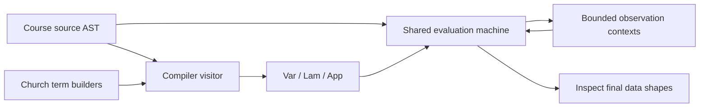

# Design: extended LAMBDA to pure lambda-calculus

## Representation and module boundaries

The compiler translates syntax rather than executing the source program.
`source.py` loads a bundled byte-for-byte copy of Assignment 5's `lambda1_vp.py`
under its canonical module name, so the submission stands alone.
`compiler.py` implements every `D0ExpVisitor` method. Its only
outputs are the immutable `Var`, `Lam`, and `App` dataclasses from `terms.py`.
There are no integer, boolean, pair, or recursion constructors in the target.
`church.py` builds closed terms for the corresponding representations and
operations. Abbreviations in this report always expand to those terms.

`evaluator.py` contains one evaluation machine for both ASTs. It does not
import the compiler, call compilation, or delegate source evaluation to the
course interpreter. `observe.py` uses that same machine to inspect target
results. `examples.py` supplies source ASTs and independent expected answers;
`demo.py` runs the pipeline and saves generated syntax and measurements.
Source transformations and printing in `source_ops.py` adapt my Assignment 5
visitors, with attribution. There are no third-party runtime dependencies.

The public interfaces keep failure states explicit. `compile_expr` either
returns syntax or raises `CompilationError`; it has no execution budget because
it performs no evaluation. `evaluate` returns completion or exhaustion, the
resulting value when completed, and the number of contractions performed.
`observe` returns decoded data only on completion, distinguishing malformed
data from an insufficient observation budget. This separation prevents a
partially reduced term from being reported as an answer. The demo additionally
checks each terminating source result against an explicit expected answer,
then checks the observed target result against that same answer. Agreement
between two erroneous execution paths alone would provide weaker evidence.



## Translation rules

Application associates left. Every multi-parameter lambda below means nested
single-parameter lambdas. `I` is `lam w. w`; `N(n)`, `T`, `F`, `PAIR`, and `Z`
are exactly the representations required in Assign06. No abbreviation remains
as a free target variable.

| Source | Translation |
| --- | --- |
| `n >= 0` | `N(n)` |
| `true`, `false` | `T`, `F` |
| `x` | `x` |
| `lam x. e` | `lam x. C[e]` |
| `e1 e2` | `C[e1] C[e2]` |
| `let x = e1 in e2` | `(lam x. C[e2]) C[e1]` |
| `if c then t else f` | `(C[c] (lam u. C[t]) (lam v. C[f])) I` |
| `not e` | `NOT C[e]` |
| `a and b` | `(C[a] (lam u. C[b]) (lam v. F)) I` |
| `a or b` | `(C[a] (lam u. T) (lam v. C[b])) I` |
| `a + b` | `ADD C[a] C[b]` |
| `a - b` | `SUB C[a] C[b]` |
| `a * b` | `MUL C[a] C[b]` |
| `a < b` | `LT C[a] C[b]` |
| `a <= b` | `LE C[a] C[b]` |
| `a > b` | `GT C[a] C[b]` |
| `a >= b` | `GE C[a] C[b]` |
| `a == b` | `EQ C[a] C[b]` |
| `a != b` | `NE C[a] C[b]` |
| `pair a b` | `PAIR C[a] C[b]` |
| `fst e`, `snd e` | `FIRST C[e]`, `SECOND C[e]` |
| `fix f(x). e` | `Z (lam f. lam x. C[e])` |

All children are translated, including unused branches and unapplied function
bodies. Unsupported operators and negative literals therefore cause useful
compilation errors even when execution would skip them. There is no constant
folding. In particular, compiling `LOOP` returns syntax without running it.

## Encodings and predecessor

A Church numeral iterates a supplied function. Addition performs the second
iteration followed by the first; multiplication uses one iteration as the
other's step. These constructions can return lambda values whose bodies still
contain applications. Such values are legitimate results of weak evaluation.

Predecessor uses a pair of Church numerals as iterator state. Start with
`(0, 0)` and transform `(previous, current)` to `(current, current + 1)`.
After `n` iterations the state is `(max(n - 1, 0), n)`, so the first projection
is predecessor. The zero case performs no transitions and returns zero.
The increment, pair construction, iteration, and projection are all pure
target applications. Python does not calculate predecessor during execution.
This version is larger than compact textbook encodings but exposes a simple
state invariant that is easy to explain and test.

```text
SUCC   = lam n s z. s (n s z)
FIRST  = lam p. p T
SECOND = lam p. p F
ADVANCE= lam p. PAIR (SECOND p) (SUCC (SECOND p))
PRED   = lam n. FIRST (n ADVANCE (PAIR N(0) N(0)))
ADD    = lam m n s z. m s (n s z)
SUB    = lam m n. n PRED m
MUL    = lam m n s. m (n s)
ZERO   = lam n. n (lam ignored. F) T
NOT    = lam b. b F T
AND    = lam p q. p q F
OR     = lam p q. p T q
LE     = lam m n. ZERO (SUB m n)
GE     = lam m n. LE n m
LT     = lam m n. NOT (LE n m)
GT     = lam m n. NOT (LE m n)
EQ     = lam m n. AND (LE m n) (LE n m)
NE     = lam m n. NOT (EQ m n)
```

The library's `AND` and `OR` take already evaluated boolean values. Source
short-circuit operators instead use the thunk translations above. Confusing
these two uses would make `false and LOOP` diverge.

## Scope and deterministic naming

Source names are retained. Each compilation initializes a fresh-name supply
with all source names, including bound names. Before introducing branch
parameters, it also reserves every name in their translated surroundings.
It selects the smallest unused `thunk_1`, `thunk_2`, and so on. The supply is
local to the call, so repeated compilations are identical. Common names such
as `s`, `z`, and `f` remain valid source identifiers. Closed library combinators
are inserted as application operands; their internal binders do not surround
translated source operands.

Target substitution reserves names from both inputs, uses a separate local
supply, and renames conflicting binders while respecting inner shadowing.
Replacement terms are inserted once without substituting inside them.
Iterative traversal avoids a Python recursion limit for deep target terms.
Source substitution respects let-initializer scope and both fix binders.
Coincident fix binders are translated as nested same-name lambdas, so the
parameter shadows the function name. These rules preserve
`FV(C[e]) = FV(e)` for open as well as closed expressions. Only execution
requires closure; compilation and substitution support free variables.

## Evaluation and resource accounting

The shared machine uses explicit continuation frames. For either AST, an
application first evaluates its function, then its argument, then applies the
function. Target application substitutes only a lambda value, counting exactly
one beta-value step. Lambda bodies are never entered merely to normalize a
value, and eta reduction is absent. Source-only frames handle data operations,
let, pairs, conditionals, and short-circuiting. Python arithmetic is confined
to these source rules; target execution only manipulates pure syntax.

The budget is checked immediately before contraction. Consequently a value
completes at budget zero, and a value reached on the last allowed contraction
also completes. Exhaustion reports that another beta step is required; it
does not prove divergence. Source terminating examples use the same machine
without a budget. Expected divergent examples run only on the bounded target
path. Each run has fresh machine state and leaves both input ASTs unchanged.

Thunks protect unselected branches because both branch arguments are lambda
values. The Church boolean selects one, and application to `I` forces it.
Recursion uses the specified call-by-value `Z`, whose self-application is
delayed behind a parameter lambda. Ordinary `Y` would repeatedly unfold
before yielding the function value needed by strict application.

## Observation and correctness claim

Natural observation applies a result to
`STEP = lam tail c z. c tail` and `BASE = lam c z. z`. Call-by-value computes a
finite spine before Python counts its inert nodes. Boolean observation applies
the result to the distinct closed markers `lam w. w` and `lam a b. a` and
compares the selected marker up to alpha-renaming. The expected kind is
mandatory because Church zero and false are alpha-equivalent. Pair observation
evaluates projections before recursively observing components. One aggregate
observation budget covers all these reductions, separately from execution.
Malformed shapes and exhausted observations never become successful answers.
This is not a universal recognizer for invalid untyped encodings.

The intended claim is that every closed, well-typed source program yielding a
natural, boolean, or finite data pair has the same observed compiled result,
given sufficient resources. Encodings relate source data to target values.
Compositional application preserves function/argument order; let preserves
initializer scope and strictness; thunks preserve conditional selection; and
`Z` implements recursive calls with the same parameter-shadowing rules.
Capture avoidance is necessary for these binding arguments. The suite checks
these obligations and compares both execution paths against explicit answers,
but finite testing cannot establish this claim for every program. A complete
proof would require a suitable relation on function values and a recursive
simulation argument. The implementation favors inspectable substitution over
environment-based target acceleration, accepting term growth as a limitation.
