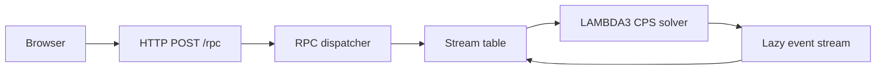

# Assignment 8: Design

The solver visits rows from zero upward and columns from left to right. Its
internal board is a list of columns in reverse row order. Every stored queen
is safe relative to all earlier queens. JSON snapshots reverse this list.

The success continuation has signature `(board, resume) -> Strm[Event]`;
`resume`, failure, safe and conflict continuations have signature
`unit -> Strm[Event]`. The answer type is always a stream. The safety checker
calls safe or conflict directly, without returning a Boolean to the search.

```text
try(row, col, board, success, exhausted):
  if col == size: exhausted()
  else emit(try, thunk:
    safe_cps(col, 1, board,
      thunk: emit(place, thunk:
        search(row+1, cons(col, board), success,
          thunk: emit(backtrack, thunk: try(row,col+1,board,success,exhausted)))),
      thunk: emit(reject, thunk: try(row,col+1,board,success,exhausted))))
```

`emit` constructs a suspended cell. Forcing it creates one event and its
suspended tail. The adapter stores the tail without forcing it. Opening only
calls the fixed solver factory, which suspends even the initial search dispatch.
No search or safety work runs until that outer thunk is forced.
A complete board calls success with the current
failure continuation, so resuming after a solution restores the last branch.
Root exhaustion emits exactly one `done`, followed by an empty stream.



Events are objects with `event` equal to `try`, `place`, `reject`, `backtrack`,
`solution`, or `done`. Candidate events include `row`, `column`, and `board`;
solution includes `board`; done has no additional fields. Place contains the
extended board; backtrack contains the restored board.

All calls use JSON-RPC 2.0 and preserve IDs. Example request/result pairs
(envelopes have `jsonrpc: "2.0"` and `id: 1`):

| Method | params | result |
| --- | --- | --- |
| service.health | `{}` | `{"status":"ok","version":"1.0"}` |
| queens.open | `{"size":8}` | `{"stream_id":"<uuid>","size":8}` |
| queens.next | `{"stream_id":"<uuid>","limit":1}` | `{"events":[{"event":"try","row":0,"column":0,"board":[]}],"done":false}` |
| queens.close | `{"stream_id":"<uuid>"}` | `{"closed":true}` |

Full exchange example:
`{"jsonrpc":"2.0","id":1,"method":"service.health","params":{}}`
returns `{"jsonrpc":"2.0","id":1,"result":{"status":"ok","version":"1.0"}}`.
Apply that envelope to each row above.
README.md also includes full request/response envelopes for all four methods.

Sizes are integers 4–10 and limits integers 1–32; Booleans are rejected.
Unknown/closed/expired streams return -32001. Inactive entries expire after
300 seconds. Exhausted streams release their lazy closures immediately and
retain only a completion marker until expiry, allowing subsequent next calls
to return empty/done. Close removes either kind of entry. A lock covers cleanup
and each stream operation. IDs are UUID4 strings and state is process-local.
The table is capped at 128 entries (-32002 if full).

Standard errors: parse -32700, envelope -32600, method -32601, params -32602,
internal -32603. Calls/errors use HTTP 200; valid notifications use 204 even
when dispatch fails. Batches are unsupported. Only fixed solver code is compiled
at startup; requests cannot supply source or callable names. Browser playback
requests one event at a time, with one outstanding request, and supports speed,
pause, step, next solution, reset, completion and visible errors.

Numeric IDs must be finite; overflowed IDs receive -32600 with null ID.
Empty/invalid JSON and invalid UTF-8 receive -32700. HTTP 415 rejects unsupported
Content-Type; 413 rejects bodies over 65,536 bytes.

Transport (`rpc`), rendering (`render`/`describe`), and playback/control functions
are separate. A busy guard permits one state-changing request at a time.
Pause invalidates the playback generation so old timers cannot resume it.
One in-flight request may finish; Start/Reset remain disabled until it finishes.
Reject descriptions explain conflicts in text and the board exposes an
accessible snapshot summary.
